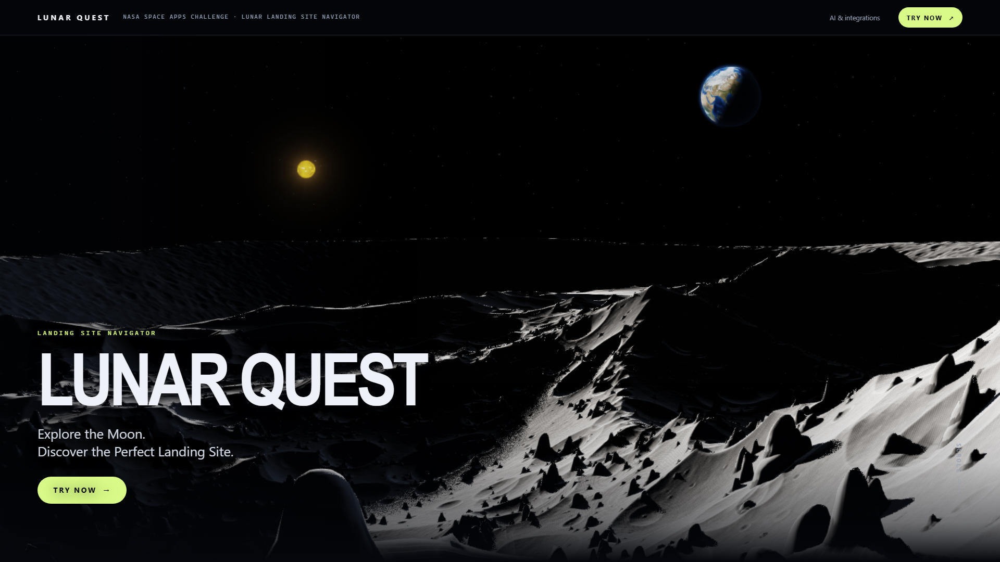
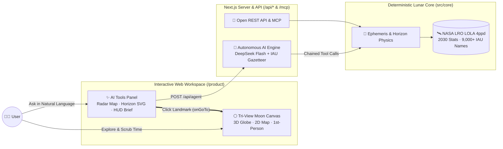
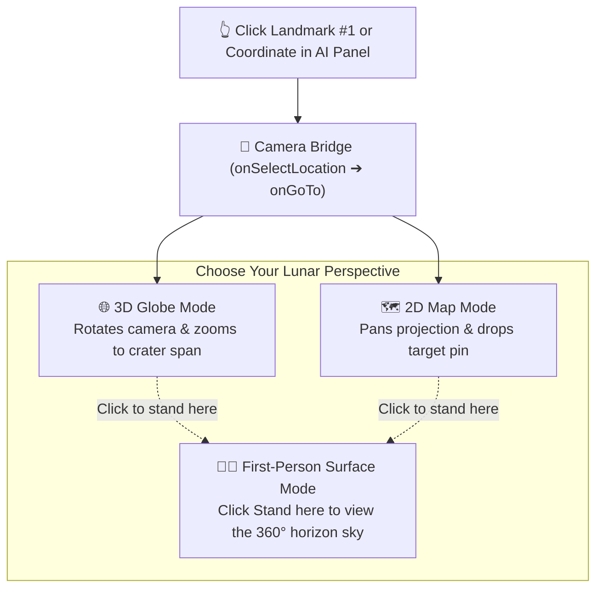
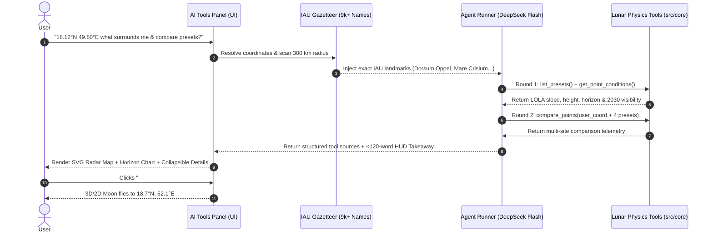

<div align="center">


<a href="https://bean-drift.vercel.app/product">
  
</a>

<p><em>Meet your guide → choose a landing site → explore your surroundings.</em></p>

<a href="https://bean-drift.vercel.app/product">
  <picture>
    <source media="(prefers-color-scheme: dark)" srcset="https://readme-typing-svg.demolab.com?font=JetBrains+Mono&amp;weight=600&amp;size=15&amp;duration=2800&amp;pause=900&amp;color=A3E635&amp;background=0B151D00&amp;center=true&amp;vCenter=true&amp;width=760&amp;lines=%3E+Ask+AI%3A+%2218.12%C2%B0N+49.80%C2%B0E+if+I+land+here+what+surrounds+me%3F%22;%3E+Render+300+km+IAU+Crater+Radar+%2B+360%C2%B0+Horizon+Chart+%2B+HUD+Brief;%3E+Click+%231+Dorsum+Oppel+%E2%9E%94+Fly+3D+Globe+%26+2D+Map+Directly+to+Target;%3E+Stand+on+the+Lunar+Surface+in+360%C2%B0+First-Person+View" />
    
  </picture>
</a>

[](README.md)
[](README.zh-CN.md)
[](https://bean-drift.vercel.app)
[](https://bean-drift.vercel.app/product)

*NASA Space Apps Challenge (Kuala Lumpur) Submission — Evaluate solar illumination (power), Earth line-of-sight (comms), terrain slope, and surrounding IAU landmarks at any lunar coordinate and UTC time.*

</div>

> [!NOTE]
> **Prior-Work Disclosure (`D-0008`)**: Base repository scaffolding, documentation templates, and early scene prototypes (`prototypes/`) were adapted from our pre-competition practice repository. Full product integration, the visual AI assistant, IAU radar schematics, and 3D/2D camera synchronization were built for the competition. See [docs/DECISION_LOG.md](docs/DECISION_LOG.md).

---

## 🖥️ Live UI & Mission Workflow Showcase

<div align="center">
  <a href="https://bean-drift.vercel.app">
    
  </a>
  <a href="https://bean-drift.vercel.app/product">
    
  </a>
  <p><em>Left: Live Low-Lunar-Orbit Landing Scene (<a href="https://bean-drift.vercel.app"><code>/</code></a>) · Right: Interactive 3D/2D Lunar Workspace & AI Assistant (<a href="https://bean-drift.vercel.app/product"><code>/product</code></a>)</em></p>
</div>

| Step 1 · Ask in Natural Language | Step 2 · Inspect Radar & Horizon Cards | Step 3 · Click Landmark to Fly on Moon |
| :---: | :---: | :---: |
| **Prompt**: *"18.12°N 49.80°E if I choose this place as my landing site what will surround me?"* | **Visual Output**: 300 km IAU schematic radar, numbered feature centers (`1 Dorsum Oppel`, `2 Mare Crisium`), and 360° terrain horizon SVG. | **Interactive Jump**: Click `#1 Dorsum Oppel` or `Show on Moon ↗` to rotate the 3D/2D Moon directly to the target coordinate and stand on the surface. |
| `Ctrl/Cmd + Enter` in **AI Tools** | Zero walls of plain text — collapsible `<details>` HUD | Seamless **3D Globe · 2D Map · 1st-Person** sync |

> [!IMPORTANT]
> ### 🏆 30-Second Judge & Reviewer Challenge (Copy & Try in `AI Tools`!)
> Open [**bean-drift.vercel.app/product**](https://bean-drift.vercel.app/product), click **AI Tools**, and paste any of these three mission prompts:
> 1. **300 km Crater Radar & Click-to-Fly**: `"18.12°N 49.80°E if I choose this place as my landing site what will surround me?"` *(Then click `#1 Dorsum Oppel` to watch the 3D Moon fly there!)*
> 2. **Autonomous Multi-Site Tradeoff**: `"Compare 85.5°S, 30.0°E with the usual landing presets at 2030-06-15T00:00:00Z."`
> 3. **14-Day Eclipse & Outage Windows**: `"Show the Sun and Earth visibility timeline at Shackleton Crater from 2030-01-01T00:00:00Z for 14 days."`

> [!TIP]
> **Try it live right now**: Open [**bean-drift.vercel.app/product**](https://bean-drift.vercel.app/product), click **AI Tools** on the left dock, pick a quick question (or type any lunar coordinate/landmark), and click any numbered crater in the schematic radar to fly the Moon camera!

---

## ✨ What Makes Bean Drift Special?

| 🛰️ Three Ways to View the Moon | 🤖 Chat-to-Fly Visual AI Assistant | 🔌 Open Science API & MCP |
| :--- | :--- | :--- |
| **1. 3D Interactive Globe**: Orbit the Moon with real-time Sun/Earth vectors and LRO LOLA overlays.<br>**2. 2D Projection Map**: Precision coordinate scouting and multi-site pinning.<br>**3. First-Person Surface View**: Stand on the lunar surface with a 360° terrain horizon, compass tape, and live Sun/Earth disks. | Stop reading walls of plain text. Ask a question in natural language and get:<br>• **300 km Nearby IAU Radar Map**<br>• **360° Sky & Terrain Horizon SVG**<br>• **14-Day Visibility Timeline Bars**<br>• **Click-to-Fly Bridge**: Click any numbered crater in the AI panel to fly the 3D/2D Moon directly to that coordinate. | Every physics calculation powers our web UI, REST API (`/api/*`), and Model Context Protocol server (`/mcp`) from a single deterministic core. |

---

## 🏗️ 1. High-Level System Architecture

A clean, four-part runtime architecture keeps credentials strictly on the server while sharing one deterministic lunar calculation core across all interfaces:



---

## 🔭 2. Multi-Vision Moon Explorer & Click-to-Fly Bridge

When you ask the AI about a coordinate or click a numbered landmark (like `1 Dorsum Oppel`) inside the **AI Tools** schematic radar, the UI synchronizes directly with the Moon viewport:



---

## 🤖 3. How the AI Procedure Works

Unlike standard chatbots that guess coordinates or output long essays, Bean Drift's agent runs a strict **multi-step verification and visual rendering pipeline**:



---

## 🔌 Live API & MCP Terminal Showcase

<details>
<summary><strong>📡 Click to expand live REST API & MCP request examples</strong></summary>

```bash
# 1. Query terrain, Sun/Earth elevation, and 2030 annual visibility at a lunar coordinate
curl "[https://bean-drift.vercel.app/api/point?lat=-89.9&lon=0&time=2030-01-01T12:00:00Z](https://bean-drift.vercel.app/api/point?lat=-89.9&lon=0&time=2030-01-01T12:00:00Z)"

# 2. Ask the autonomous lunar AI assistant via POST /api/agent
curl -X POST "[https://bean-drift.vercel.app/api/agent](https://bean-drift.vercel.app/api/agent)" \
  -H "Content-Type: application/json" \
  -d '{"message":"At 18.12N 49.80E what craters surround me?"}'
```

</details>

---

## 📂 Repository Structure

- `app/` & `src/`: Next.js application (**Bean Drift**)
  - `src/core/`: Analytical ephemeris, horizon masking, annual stats, and read-only tools (`get_point_conditions`, `compare_points`, `get_point_timeline`, `compare_dates`, `find_sites`, `list_presets`)
  - `src/features/agent-search/`: Autonomous AI assistant, IAU gazetteer matcher, SVG visual cards, and nearby radar map
  - `src/ui/product/`: 3D Globe, 2D Map, First-Person surface renderer, timeline scrubber, and mission panels
- `public/data/v1/` & `public/product/moon/`: Precomputed NASA LRO LOLA terrain, horizon envelopes, 2030 illumination stats, and IAU lunar nomenclature
- `prototypes/`: Early scene & landing page prototypes ([prototypes/README.md](prototypes/README.md))
- `docs/`: Architecture decisions, deployment guides, and team logs ([docs/README.md](docs/README.md))

---

## 🚀 Run Anywhere: Cloud Website · Docker · Windows/macOS · Linux · CI/CD

Bean Drift is a **self-contained lunar navigation product** with all NASA LRO LOLA terrain grids, horizon profiles, 2030 visibility tables, and IAU nomenclature bundled directly in the repository:

| 🌐 Cloud Website | 🐳 Docker Container | 💻 Windows & macOS | 🐧 Linux & WSL2 | ⚙️ GitHub Actions CI |
| :--- | :--- | :--- | :--- | :--- |
| **Zero Install Browser**<br>Live on Vercel Edge with WebGL 3D/2D & DeepSeek Flash AI.<br><br>👉 [**bean-drift.vercel.app**](https://bean-drift.vercel.app)<br>👉 [**Launch `/product`**](https://bean-drift.vercel.app/product) | **One-Command Container**<br>Package the entire 3D/2D app, NASA datasets & `/mcp` server into an isolated image.<br><br>`docker build -t bean-drift .`<br>`docker run -p 3000:3000 bean-drift` | **Local Desktop PC**<br>Run natively on Windows PowerShell or macOS with Node.js 20+.<br><br>`git clone ...`<br>`npm install && npm run dev` | **Native & Headless Server**<br>Runs on Ubuntu, Debian & WSL2 as a full workspace or standalone REST/MCP node.<br><br>`npm run build && npm start` | **Automated Linux Gates**<br>Every push & PR runs `npm run typecheck` and 101+ tests (`npm test`) on Ubuntu runners. |

<details>
<summary><strong>🐳 Click to expand Docker, Linux & Local Setup Commands</strong></summary>

```bash
# Option A: Run with Docker (passing optional DeepSeek API key for live AI Tools)
docker build -t bean-drift .
docker run --rm -p 3000:3000 -e DEEPSEEK_API_KEY=your_key_here bean-drift

# Option B: Run natively on Windows PowerShell, macOS, Linux, or WSL2
git clone [https://github.com/xbl2602/bean-drift.git](https://github.com/xbl2602/bean-drift.git)
cd bean-drift
npm install
npm run dev       # Starts http://localhost:3000
npm run typecheck && npm test
```

</details>

- **REST & MCP Endpoints**: `/api/health`, `/api/presets`, `/api/point`, `/api/compare`, `/api/timeline`, `/api/compare-dates`, `/api/find-sites`, `/api/agent`, `/mcp`

### Onboarding Reading Order
1. [AGENTS.md](AGENTS.md) — Repository rules & directory ownership
2. [docs/TEAM_HANDBOOK.md](docs/TEAM_HANDBOOK.md) — Roles & workflow
3. [docs/FEATURE_SPEC.md](docs/FEATURE_SPEC.md) — Feature specifications
4. [docs/GIT_GUIDE.md](docs/GIT_GUIDE.md) — Git & PR checklist

---

## 👥 Team & Credits

| Pilot | GitHub | Mission Role |
| :---: | :--- | :--- |
| <a href="https://github.com/xbl2602"></a> | [**@xbl2602**](https://github.com/xbl2602) | **Lead Backend Architect & Project Manager** — Core ephemeris, LOLA data pipeline, REST & MCP server |
| <a href="https://github.com/louis068"></a> | [**@louis068**](https://github.com/louis068) | **AI Search, Backend & Documentation** — Natural-language search and multi-step lunar tools; IAU landmark lookup, visual answer cards and click-to-fly integration; tool-input validation and untrusted-context safeguards; bilingual README, architecture diagrams and animated showcase |
| <a href="https://github.com/chanjy0806"></a> | [**@chanjy0806**](https://github.com/chanjy0806) | **Frontend Engineer (Landing)** — Interactive low-lunar-orbit satellite scene & onboarding storytelling |
| <a href="https://github.com/ShanLe1224"></a> | [**@ShanLe1224**](https://github.com/ShanLe1224) | **Frontend Engineer (Product)** — 3D Globe, 2D Map, First-Person surface view & mission analysis panels |
| <a href="https://github.com/leeziqi0531-debug"></a> | [**@leeziqi0531-debug**](https://github.com/leeziqi0531-debug) | **Pitch, Documentation & Mission Operations** — Demo production, mission storytelling, project documentation and QA verification |

Built with public lunar datasets from **NASA LRO LOLA**, **LROC NAC**, **NASA SVS CGI Moon Kit**, and the **IAU/USGS Planetary Gazetteer**. Full attribution in [docs/CREDITS.md](docs/CREDITS.md).
