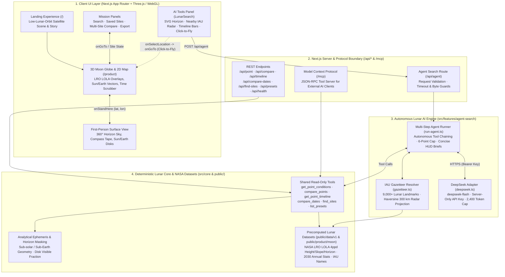

# Bean Drift — Lunar Landing Site Navigator (月球着陆点导航仪)

[](https://bean-drift.vercel.app)
[](https://bean-drift.vercel.app/product)
[](https://bean-drift.vercel.app/mcp)

**NASA Space Apps Challenge (Kuala Lumpur) Submission / 吉隆坡站参赛作品** — 让任务规划者、教育者和公众都能**快速比较月面任意位置、任意日期的光照（发电）、对地通信条件、地形坡度与周围地标**的交互式 3D/2D 月面导航平台、AI 选址助手与开放接口（REST API + MCP）。

> **Prior-Work Disclosure / 说明 (`D-0008`)**：框架、文档体系和早期原型（`prototypes/`）沿用自赛前演练仓库，是已有基础，不是现场从零新写的；比赛期间完成的完整产品页、AI 视觉问答、IAU 地名雷达与 3D/2D 联动详见 [docs/DECISION_LOG.md](docs/DECISION_LOG.md) D-0008。

---

## 1. System Architecture (Archify Runtime View / 系统运行架构)

Bean Drift 采用**四层严格边界架构**，使前端 3D/2D WebGL 视图、REST API、MCP 协议服务以及 DeepSeek Flash 智能体共享同一套**确定性的月球物理与地形计算核心（`src/core/`）**，保证所有通道的数据溯源一致且密钥永不暴露给浏览器。



---

## 2. Core Features / 核心功能

- **Interactive 3D Globe, 2D Map & First-Person Surface View (`/product`)**：支持在 3D 月球仪、2D 投影地图与月面第一人称视角（360° 真实地形天际线、太阳/地球视盘、罗盘带）之间无缝切换，拖动时间轴即可实时观察太阳与阴影变化。
- **Visual Lunar AI Assistant (`AI Tools`)**：基于 `deepseek-flash` 与只读月球工具链，自动生成 SVG 地平线图、附近 300 km IAU 陨石坑/山脊雷达示意图（`NearbyMap`）、多点光照对比条和可见时间轴。支持点击示意图或列表中的编号地标直接旋转并缩放 3D/2D 月球至目标坐标（Click-to-Fly），并采用精简结论 + 可折叠详细遥测说明（`<details>`）。
- **Multi-Site Comparison & Global Site Finder**：支持多达 10 个候选点（AI 单次对比上限 6 个点）的坡度、高程、2030 全年日照率、对地可见率与最长黑夜时长对比，并可按纬度、最大坡度、最短日照筛选全月 0.25° 网格。
- **Open REST API & MCP Server (`/api/*` & `/mcp`)**：所有月面计算能力均通过标准 REST 接口与 Model Context Protocol (`/mcp`) 开放，方便外部脚本或其他 AI 客户端直接调用。

---

## 3. Repository Structure / 现在仓库里有什么

- `app/` & `src/`：Next.js 产品代码（项目名 **Bean Drift**）
  - `src/core/`：月球星历、地形遮挡、年度统计与共享只读工具（`get_point_conditions`、`compare_points`、`get_point_timeline`、`compare_dates`、`find_sites`、`list_presets`）
  - `src/features/agent-search/`：AI 自然语言选址助手（DeepSeek 适配层、IAU 月球地名解析、SVG 可视化卡片与附近地形雷达图）
  - `src/ui/product/`：3D/2D 月球渲染器、第一人称表面视图、时间轴与工具面板
- `public/data/v1/` & `public/product/moon/`：预计算的 NASA LRO LOLA 地形、天际线包络、2030 年度光照统计与 IAU 官方月面地名库
- `prototypes/`：早期原型（`lunar-scene-demo/` 月面第一人称场景与两版 landing page 视觉原型），运行方法见 [prototypes/README.md](prototypes/README.md)
- `docs/`：全部设计、部署与团队文档，目录见 [docs/README.md](docs/README.md)

---

## 4. Quick Start & Live Endpoints / 快速开始与线上地址

- **线上地址 (Live Production)**：https://bean-drift.vercel.app
- **产品工作台 (Navigator Workspace)**：https://bean-drift.vercel.app/product
- **开放接口 (API & MCP)**：`/api/health`、`/api/presets`、`/api/point`、`/api/compare`、`/api/timeline`、`/api/compare-dates`、`/api/find-sites`、`/api/agent`、`/mcp`

```bash
npm install
npm run dev     # Starts local server at http://localhost:3000
npm run typecheck
npm test
```

---

## 5. 第一次来？按这个顺序读 (Onboarding Docs)

1. [AGENTS.md](AGENTS.md)：所有人和所有 AI 要遵守的规则
2. [docs/TEAM_HANDBOOK.md](docs/TEAM_HANDBOOK.md)：谁负责什么、第一天做什么
3. [docs/FEATURE_SPEC.md](docs/FEATURE_SPEC.md)：我们要做什么
4. [docs/GIT_GUIDE.md](docs/GIT_GUIDE.md)：Git 步骤（有人话解释）
5. [docs/DEPLOYMENT.md](docs/DEPLOYMENT.md)：本地环境变量与 Vercel 部署说明

---

## 6. Team / 团队

| GitHub | 角色 |
|---|---|
| `xbl2602` | 后端主架构 + 项目经理 |
| `louis068` | 后端：AI 搜索助手、可视化问答与各类小功能 |
| `chanjy0806` | 前端：landing page 与低轨卫星场景 |
| `ShanLe1224` | 前端：product page 与 3D/2D 交互面板 |
| `leeziqi0531-debug` | pitch 视频 + 打杂 |

## 7. Data & Credits / 数据与版权

使用了 NASA LRO LOLA、LROC NAC、NASA SVS CGI Moon Kit 与 USGS/IAU 公开月面地名数据；素材、数据和 AI 使用登记见 [docs/CREDITS.md](docs/CREDITS.md)。
