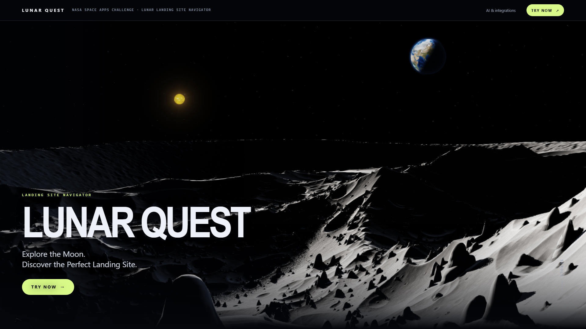
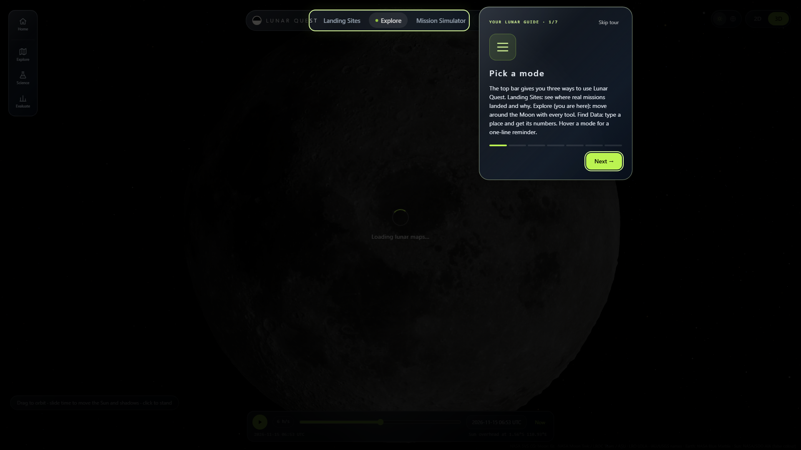
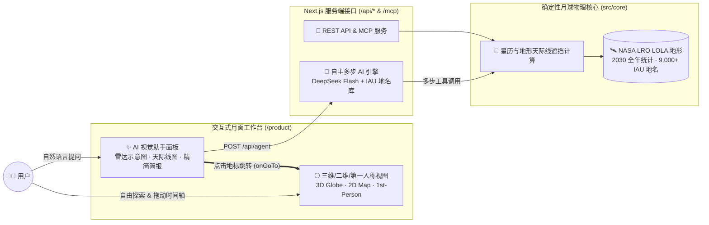
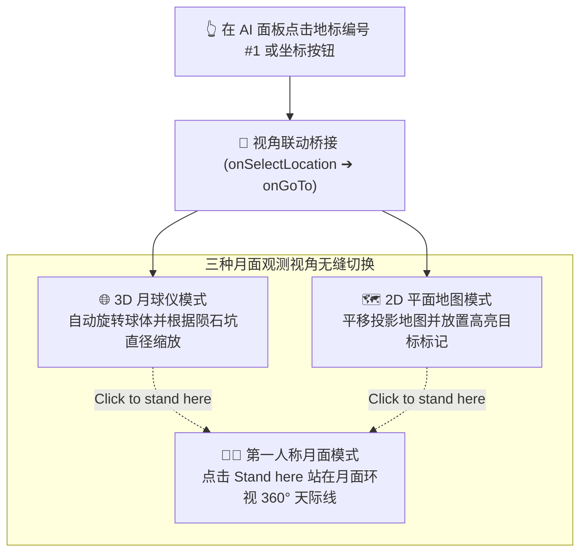
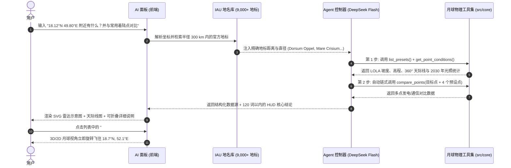

<div align="center">


<a href="https://bean-drift.vercel.app/product">
  
</a>

<p><em>认识向导 → 选择着陆点 → 探索周围地形。点击进入月球导航。</em></p>

<a href="https://bean-drift.vercel.app/product">
  <picture>
    <source media="(prefers-color-scheme: dark)" srcset="https://readme-typing-svg.demolab.com?font=JetBrains+Mono&amp;weight=600&amp;size=15&amp;duration=2800&amp;pause=900&amp;color=A3E635&amp;background=0B151D00&amp;center=true&amp;vCenter=true&amp;width=760&amp;lines=%3E+Ask+AI%3A+%2218.12%C2%B0N+49.80%C2%B0E+%E9%99%84%E8%BF%91%E6%9C%89%E4%BB%80%E4%B9%88%E9%99%A8%E7%9F%B3%E5%9D%91%E5%92%8C%E5%9C%B0%E6%A0%87%EF%BC%9F%22;%3E+%E5%AE%9E%E6%97%B6%E7%94%9F%E6%88%90+300+km+IAU+%E9%9B%B7%E8%BE%BE%E7%A4%BA%E6%84%8F%E5%9B%BE+%2B+360%C2%B0+%E5%A4%A9%E9%99%85%E7%BA%BF%E5%9B%BE;%3E+%E7%82%B9%E5%87%BB+%231+Dorsum+Oppel+%E2%9E%94+3D%2F2D+%E6%9C%88%E7%90%83%E8%A7%86%E8%A7%92%E7%AB%8B%E5%8D%B3%E6%97%8B%E8%BD%AC%E5%AE%9A%E4%BD%8D;%3E+%E4%B8%80%E9%94%AE%E5%88%87%E6%8D%A2%E6%9C%88%E9%9D%A2%E7%AC%AC%E4%B8%80%E4%BA%BA%E7%A7%B0%E8%A7%86%E8%A7%92%E7%8E%AF%E8%A7%86%E7%9C%9F%E5%AE%9E%E5%9C%B0%E5%BD%A2" />
    
  </picture>
</a>

[](README.md)
[](README.zh-CN.md)
[](https://bean-drift.vercel.app)
[](https://bean-drift.vercel.app/product)

*NASA Space Apps Challenge（吉隆坡站）参赛作品 —— 快速评估并对比月面任意坐标、任意日期的太阳光照（发电）、地球视线（通信）、地形坡度与周围 IAU 官方地标。*

</div>

> [!NOTE]
> **赛前基础声明 (`D-0008`)**：框架、文档体系和早期原型（`prototypes/`）沿用自赛前演练仓库，非现场从零新写；比赛期间完成的完整产品页、AI 视觉问答、IAU 雷达示意图与 3D/2D 视角联动详见 [docs/DECISION_LOG.md](docs/DECISION_LOG.md) D-0008。

---

## 🖥️ 交互界面与三步选址体验展示

<div align="center">
  <a href="https://bean-drift.vercel.app">
    
  </a>
  <a href="https://bean-drift.vercel.app/product">
    
  </a>
  <p><em>左：月球低轨卫星首页场景（<a href="https://bean-drift.vercel.app"><code>/</code></a>） · 右：3D/2D 月面工作台与 AI 视觉选址助手（<a href="https://bean-drift.vercel.app/product"><code>/product</code></a>）</em></p>
</div>

| 第一步 · 自然语言提问 | 第二步 · 获取雷达图与天际线卡片 | 第三步 · 点击地标编号飞往月球 |
| :---: | :---: | :---: |
| **输入问题**：*"18.12°N 49.80°E if I choose this place as my landing site what will surround me?"* | **可视化输出**：自动绘制 300 km IAU 地标雷达示意图（`1 Dorsum Oppel`、`2 Mare Crisium`）与 360° 地形天际线 SVG。 | **视角联动**：点击 `#1 Dorsum Oppel` 或 `Show on Moon ↗`，右侧 3D/2D 月球立即旋转缩放至目标坐标，并可一键站在月面环视。 |
| 在 **AI Tools** 面板按 `Ctrl/Cmd + Enter` | 告别枯燥长文 —— 核心结论 + `<details>` 折叠详情 | **3D 月球仪 · 2D 地图 · 第一人称**实时同步 |

> [!IMPORTANT]
> ### 🏆 30 秒评委极速体验挑战（复制并粘贴至 `AI Tools` 即可验证！）
> 打开 [**bean-drift.vercel.app/product**](https://bean-drift.vercel.app/product)，点击左侧 **AI Tools**，复制以下任一问题体验核心功能：
> 1. **300 km 陨石坑雷达 + 点击飞往月球**：`"18.12°N 49.80°E 如果选这里作为着陆点，我周围会有什么？"` *（回答生成后点击 `#1 Dorsum Oppel`，3D/2D 月球立即旋转定位！）*
> 2. **自主多步预设着陆点对比**：`"把 85.5°S, 30.0°E 和常用预设着陆点在 2030-06-15T00:00:00Z 进行对比。"`
> 3. **14 天日照与通信窗口时间轴**：`"展示 Shackleton Crater 从 2030-01-01T00:00:00Z 开始 14 天的太阳与地球可见时间轴。"`

> [!TIP]
> **立即在线体验**：打开 [**bean-drift.vercel.app/product**](https://bean-drift.vercel.app/product)，点击左侧 **AI Tools** 按钮，选择快捷问题或输入任意坐标/陨石坑名称，再点击示意图下的数字编号即可看到 3D/2D 月球自动旋转定位！

---

## ✨ 核心亮点：为什么选择 Bean Drift？

| 🛰️ 三种月球观测视角 | 🤖 对话即跳转的 AI 视觉助手 | 🔌 开放科学接口 (REST + MCP) |
| :--- | :--- | :--- |
| **1. 3D 交互月球仪**：自由旋转缩放，实时展示太阳/地球方向矢量与坡度/光照图层。<br>**2. 2D 投影地图**：精准经纬度选点与多着陆点同屏标记。<br>**3. 月面第一人称视角**：站在月球表面观察 360° 真实地形天际线、罗盘带与太阳/地球视盘。 | 告别枯燥的大段纯文本！用自然语言提问即可获得：<br>• **300 km 附近 IAU 陨石坑雷达示意图**<br>• **360° 天际线与地形遮挡 SVG 图**<br>• **14 天日照/对地可见时间窗条形图**<br>• **Click-to-Fly 视角联动**：点击 AI 回答中的编号地标，3D/2D 月球立即旋转聚焦至该坐标。 | 前端界面、REST API (`/api/*`) 与 Model Context Protocol (`/mcp`) 共享同一套确定性月球物理计算核心，绝不编造坐标或星历数据。 |

---

## 🏗️ 1. 系统总体架构 (精简视图)



---

## 🔭 2. 多视角月球浏览与 AI 点击跳转 (Click-to-Fly)

当你在 **AI Tools** 面板点击附近地标编号（如 `1 Dorsum Oppel`）、雷达图圆点或坐标卡片时，主画布会自动定位到对应月面位置：



---

## 🤖 3. AI 选址助手工作流程 (Procedure)

AI 助手绝不凭空猜测数据，而是通过 **IAU 地名解析 ➔ 多步物理工具链调用 ➔ SVG 图形渲染 + 折叠简报** 完成回答：



---

## 🔌 开放接口 (REST API & MCP) 调用示例

<details>
<summary><strong>📡 点击展开 REST API 与 AI 接口终端调用命令</strong></summary>

```bash
# 1. 查询月面单点地形、太阳/地球仰角与 2030 全年光照统计
curl "https://bean-drift.vercel.app/api/point?lat=-89.9&lon=0&time=2030-01-01T12:00:00Z"

# 2. 调用自然语言 AI 选址助手 (POST /api/agent)
curl -X POST "https://bean-drift.vercel.app/api/agent" \
  -H "Content-Type: application/json" \
  -d '{"message":"18.12N 49.80E 附近有什么地标？"}'
```

</details>

---

## 🚀 多平台部署与 CI/CD（网页云端 · Docker · Windows/macOS · Linux）

Bean Drift 采用**零外部数据库依赖的自包含架构**——所有 NASA LRO LOLA 地形网格、天际线包络、2030 全年光照数据与 IAU 地名库均内置于仓库中，支持全场景运行与部署：

| 🌐 网页云端 (Vercel) | 🐳 Docker 容器化部署 | 💻 Windows & macOS | 🐧 Linux & WSL2 | ⚙️ GitHub Actions CI |
| :--- | :--- | :--- | :--- | :--- |
| **免安装浏览器即开即用**<br>支持 WebGL 3D/2D 渲染与服务端 DeepSeek Flash AI。<br><br>👉 [**bean-drift.vercel.app**](https://bean-drift.vercel.app)<br>👉 [**进入 `/product` 工作台**](https://bean-drift.vercel.app/product) | **一键镜像打包与隔离运行**<br>将 3D/2D 前端、NASA 地形数据与 `/mcp` 接口封装为标准容器。<br><br>`docker build -t bean-drift .`<br>`docker run -p 3000:3000 bean-drift` | **个人电脑本地运行**<br>在 Windows PowerShell 或 macOS 下使用 Node.js 24.x 独立运行。<br><br>`git clone ...`<br>`npm install && npm run dev` | **原生 Linux 与服务端**<br>兼容 Ubuntu、Debian 与 WSL2，可作为完整工作台或独立 API/MCP 节点。<br><br>`npm run build && npm start` | **Ubuntu 自动测试门禁**<br>每次提交与 PR 均自动执行 `npm run typecheck` 与 101+ 项测试（`npm test`）。 |

<details>
<summary><strong>🐳 点击展开 Docker 容器、Linux 与本地电脑快速启动命令</strong></summary>

```bash
# 方式 A：使用 Docker 一键构建并运行（可选传入 DEEPSEEK_API_KEY 启用 AI 助手）
docker build -t bean-drift .
docker run --rm -p 3000:3000 -e DEEPSEEK_API_KEY=你的密钥 bean-drift

# 方式 B：在 Windows PowerShell、macOS、Linux 或 WSL2 下直接运行
git clone https://github.com/xbl2602/bean-drift.git
cd bean-drift
npm install
npm run dev       # 访问 http://localhost:3000
npm run typecheck
npm test
```

</details>

---

## 📂 现在仓库里有什么

- `app/` & `src/`：Next.js 产品代码（项目名 **Bean Drift**）
- `prototypes/`：早期原型（`lunar-scene-demo/` 月面第一人称场景与两版 landing page 视觉原型），运行方法见 [prototypes/README.md](prototypes/README.md)
- `docs/`：全部文档，新人必读顺序：[AGENTS.md](AGENTS.md) ➔ [docs/TEAM_HANDBOOK.md](docs/TEAM_HANDBOOK.md) ➔ [docs/FEATURE_SPEC.md](docs/FEATURE_SPEC.md) ➔ [docs/GIT_GUIDE.md](docs/GIT_GUIDE.md)
- 线上地址：https://bean-drift.vercel.app （接口：`/api/health`、`/api/point`、`/api/compare`、`/api/timeline`、`/api/find-sites`、`/api/presets`、`/api/agent`、`/mcp`）

## 项目文档与技术说明

[打开 Google Docs 项目文档](https://docs.google.com/document/d/1oGul3ofiNASOeoQNFWHs3nDmCb4unRww-JEW6Azwnso/edit?usp=drive_link) · [部署指南](docs/DEPLOYMENT.md) · [API 与 MCP 接口](docs/SHARED_INTERFACES.md) · [数据流水线](pipeline/README.md)

### 其他功能
- **太阳能量估算**：`/api/energy` 与 `get_solar_energy_estimate` 提供入射太阳能量和黑夜电池需求估算。入射能量不等于发电量，未包含面板效率、灰尘与温度损失。
- **南极地形**：覆盖区域可使用打包的 160 m 南极地形；全月概览仍为 0.25°。实际分辨率以结果的来源说明为准。

### 数据边界
- 星历使用解析近似，不是 SPICE，也不是任务级着陆预测。
- 预计算全月年度统计覆盖 **2030 年**；改变查询日期不会改变这套数据的统计年份。
- 格子平均坡度不能证明着陆安全；附近地标图是示意图，不是现场照片。
- AI 每次工具调用最多比较 **6 个点**；聊天记录虽可见，每个问题仍独立处理。

### 配置与验证
使用与 `package.json` 一致的 **Node.js 24.x**。地图、REST API 和 MCP 不需要 AI 密钥。AI Tools 的 `DEEPSEEK_API_KEY` 由负责人放在服务端 `.env.local` 或 Vercel 环境变量中；禁止提交密钥或使用 `NEXT_PUBLIC_` 前缀。未配置时 agent 接口返回 503。

```bash
npm run typecheck
npm test
npm run build
```

部署与 Docker 配置见[部署指南](docs/DEPLOYMENT.md)。Google 文档可能需要向文档拥有者申请访问；仓库权限不等于文档权限。

---

## 👥 团队与版权

| 成员头像 | GitHub | 角色与职责 |
| :---: | :--- | :--- |
| <a href="https://github.com/xbl2602"></a> | [**@xbl2602**](https://github.com/xbl2602) | **后端主架构 + 项目经理** —— 核心月球物理计算、LOLA 数据管线、REST API 与 `/mcp` 服务 |
| <a href="https://github.com/louis068"></a> | [**@louis068**](https://github.com/louis068) | **后端与 AI 研发** —— 自主多步 AI 选址助手、IAU 地标雷达图、SVG 可视化卡片与 3D/2D 视角联动 |
| <a href="https://github.com/chanjy0806"></a> | [**@chanjy0806**](https://github.com/chanjy0806) | **前端研发 (Landing Page)** —— 月球低轨卫星 3D 场景与交互叙事首页 |
| <a href="https://github.com/ShanLe1224"></a> | [**@ShanLe1224**](https://github.com/ShanLe1224) | **前端研发 (Product Page)** —— 3D 月球仪、2D 地图、月面第一人称视角与任务分析面板 |
| <a href="https://github.com/leeziqi0531-debug"></a> | [**@leeziqi0531-debug**](https://github.com/leeziqi0531-debug) | **Pitch 视频与项目运营** —— 演示视频制作、路演叙事与全流程测试支持 |

使用了 NASA LOLA、LROC NAC、NASA SVS CGI Moon Kit 与 IAU 公开数据；素材、数据和 AI 使用登记见 [docs/CREDITS.md](docs/CREDITS.md)。
